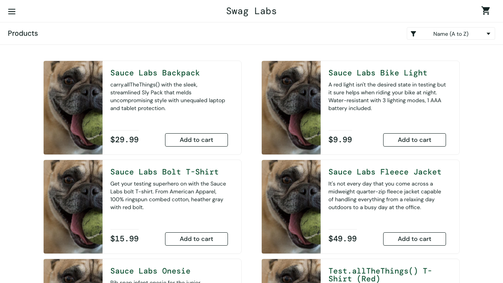
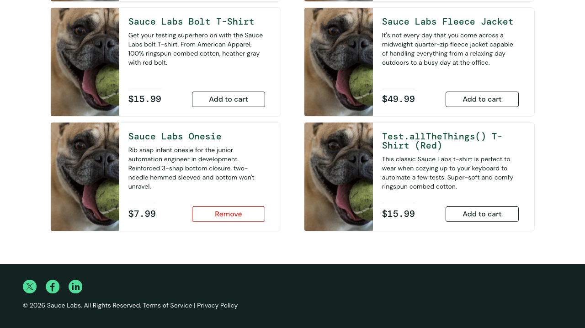
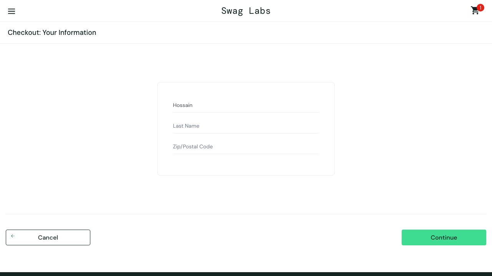
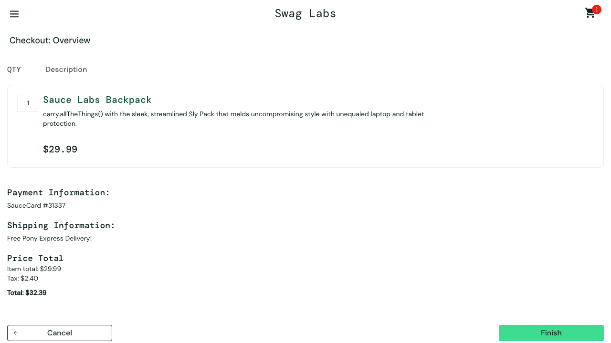

# Bug reports

Found while testing [SauceDemo](https://www.saucedemo.com), a practice store that has deliberate bugs on some test accounts. Each bug is guarded by a test in [`tests/ui/known-bugs.spec.ts`](tests/ui/known-bugs.spec.ts) marked as an expected failure. When a bug is fixed, that test "unexpectedly passes" and fails the run, which reminds us to close the bug.

Screenshots are produced by the tests themselves (`npm run screenshots`).

**Environment:** Chrome 1280×720 (desktop) and Safari (iPhone 15 emulation), Playwright 1.64. Password for every account: `secret_sauce`.

| ID | Title | Severity | Account |
|---|---|---|---|
| [BUG-01](#bug-01-every-product-shows-the-same-image) | Every product shows the same image | Medium | `problem_user` |
| [BUG-02](#bug-02-sorting-by-price-does-not-change-the-order) | Sorting by price does not change the order | Medium | `problem_user` |
| [BUG-03](#bug-03-half-of-the-add-to-cart-buttons-do-nothing) | Half of the "Add to cart" buttons do nothing | High | `problem_user` |
| [BUG-04](#bug-04-typing-in-last-name-overwrites-first-name) | Typing in Last Name overwrites First Name | Critical | `problem_user` |
| [BUG-05](#bug-05-finish-does-not-complete-the-order) | "Finish" does not complete the order | Critical | `error_user` |

---

### BUG-01: Every product shows the same image
**Severity:** Medium. Users cannot tell products apart by picture.

**Steps**
1. Log in as `problem_user`.
2. Look at the product list.

**Expected:** each of the 6 products shows its own photo.
**Actual:** all 6 products show the same dog photo (1 unique image for 6 products).

---

### BUG-02: Sorting by price does not change the order
**Severity:** Medium. Shoppers cannot find the cheapest item.

**Steps**
1. Log in as `problem_user`.
2. Choose **Price (low to high)** in the sort menu.

**Expected:** 7.99, 9.99, 15.99, 15.99, 29.99, 49.99.
**Actual:** the order does not change: 29.99, 9.99, 15.99, 49.99, 7.99, 15.99.

---

### BUG-03: Half of the "Add to cart" buttons do nothing
**Severity:** High. Users cannot buy half of the products.

**Steps**
1. Log in as `problem_user`.
2. Click **Add to cart** on all 6 products.

**Expected:** every button turns into **Remove** and the cart badge shows 6.
**Actual:** only 3 buttons react; the cart badge shows 3. Bolt T-Shirt, Fleece Jacket and Test.allTheThings() T-Shirt stay on **Add to cart**.

---

### BUG-04: Typing in Last Name overwrites First Name
**Severity:** Critical. Checkout cannot be completed.

**Steps**
1. Log in as `problem_user`, add any product, open the cart, click **Checkout**.
2. Type `Sabbir` in **First Name**.
3. Click **Last Name** and type `Hossain`.

**Expected:** First Name = `Sabbir`, Last Name = `Hossain`.
**Actual:** the text goes into **First Name** (now `Hossain`, `Sabbir` is lost) and **Last Name** stays empty, so the form fails with "Last Name is required".

---

### BUG-05: "Finish" does not complete the order
**Severity:** Critical. The payment flow is blocked.

**Steps**
1. Log in as `error_user`, add **Sauce Labs Backpack**, open the cart, click **Checkout**.
2. Fill in First Name, Last Name and Postal Code, click **Continue**.
3. Click **Finish**.

**Expected:** "Thank you for your order!" confirmation page.
**Actual:** the page stays on the overview and no confirmation is shown.

